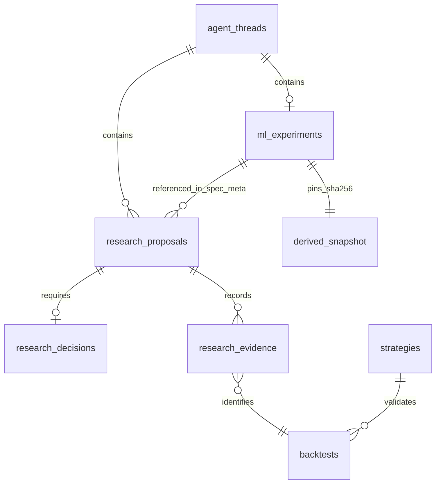

# Approval-gated ML research foundation

This increment adds an opt-in **API workflow**, not a running research program.
It proposes, approves, fits, records, and exports one bounded discovery experiment.
It does not schedule experiments, access the final platform holdout, run paper/live
orders, or claim profitability. Existing chat, strategies, charts, packaging and
proposal review continue to use their current interfaces.

The first method, `volume_threshold_v1`, is a deliberately small reference plugin:
learn a threshold on completed one-minute ES bar volume, then emit a plain Strategy
Spec expression. It is not a recommended trading hypothesis or a selected model
roadmap. The user must choose to test it, and supply every plan field. No real-market
hypothesis was run while implementing this feature; all new tests use synthetic data.

## Workflow and approval boundaries

1. Create a research thread with `POST /api/agent/threads`.
2. Submit a complete plan to `POST /api/agent/threads/{threadId}/ml-experiments`.
   This validates inputs and freezes a bounded OHLCV snapshot; it does **not fit**.
3. Read the returned immutable document and SHA-256 digest. It includes all choices,
   derived-data identity, source/config/dependency fingerprints, and partition counts.
4. `POST .../ml-experiments/{id}/decision` with `digest`, `action: "approve"`, and a
   nonempty `reason` records the user's exact approval. `reject_stop` stops this thread.
5. Separately call `POST .../ml-experiments/{id}/run`. Only then can training occur.
   SQLite reserves the run before fitting. Concurrent requests and retries cannot
   fit it again. This endpoint is bounded and synchronous, with no automatic retries.
6. `GET .../ml-experiments` retains the plan, immutable decision, all searched
   thresholds, selected trigger, metrics, result digest and terminal outcome.
7. For a `candidate`, `POST .../{id}/candidate-proposal` accepts `{strategy, testPlan}`.
   Supply all existing execution/risk/session/exit choices; the server replaces only
   `entry.trigger` with the learned rule and stamps discovery provenance in `meta`.
   This creates an ordinary **unapproved** research proposal. The Desk's existing
   proposal review can inspect it; the existing approve and queue actions are still
   required before Nautilus can test it. Missing choices remain a blocked draft.
8. Approved strategy specs retain their ordinary Nautilus path and package export.
   A threshold expression requires no Python deserialization, pickle, or model
   dependency at strategy execution time.

No discovery controls are exposed to the language model. Plan entry currently uses
the API/OpenAPI UI (`/docs`); a dedicated discovery form is deferred. Export requires
ES1!, primary 1min with no context, matching direction, and no filters or entry
sequence. User-chosen sessions, exits and sizing can change outcomes: this is exact
**signal** export, not a claim that forward-label scores reproduce strategy PnL.

One discovery plan is allowed per thread. Revision/retry needs a new thread and
approval; history and the global recorded-attempt count remain. A `reject_stop`
blocks both discovery and later strategy queues in the same thread. It does not
cancel already dispatched legacy Nautilus jobs. A process crash can leave a run
`running`; it cannot automatically resume or refit. Inspect that record and create
a new explicitly approved experiment if needed. Technical failures are `blocked`,
never `no_edge`. Threshold retries are not permitted after a test failure.

## Explicit plan contract

All these fields are required; there is no executable default request:

| Fields | Meaning |
|---|---|
| `hypothesis` | The hypothesis the user wants to test |
| `method`, `symbol`, `interval` | `volume_threshold_v1`, `ES1!`, `1min` in this increment |
| `direction` | Explicit `long` or `short` |
| `start`, `trainEnd`, `validationEnd`, `testEnd` | Inclusive ET session dates, with ordered disjoint partitions |
| `target` | `next_open_to_horizon_close_ticks` |
| `horizonBars` | 1–60 forward bars, explicitly selected |
| `roundTripCostTicks` | Explicit nonnegative total cost estimate in ES ticks |
| `quantiles` | Unique quantiles strictly inside (0, 1), fitted on training volume only |
| `maxCandidates` | Explicit search budget; two threshold directions per quantile, at most 100 |
| `minTrainSignals`, `minEvaluationSignals` | Explicit positive sample-count requirements |
| `minMeanNetTicks` | Explicit minimum conditional forward outcome |
| `minImprovementOverBaselineTicks` | Nonnegative improvement in net ticks per observation |
| `multipleTestingPolicy` | `descriptive_only_no_significance_claim` |

The 366-day, 50,000-bar, 12 MB snapshot and 100-candidate limits are software resource
limits, not trading recommendations. Unknown fields/methods, missing choices,
non-finite values, non-ES inputs and unavailable dates fail closed.

## Chronology, target alignment and reproducibility

Partitions are made **before** constructing forward labels. At the close of bar i,
its volume is known. The label is `(close[i+h] - open[i+1]) / tickSize`, multiplied
by the explicitly chosen side, less round-trip costs. Timestamps refer to bar opens;
label availability is the close of i+h. Targets must remain within the partition,
within the same ET RTH session, and span h contiguous minute bars. Missing bars,
session endings and partition endings are purged, never bridged or imputed.

Training-only quantiles are the only learned preprocessing for this plugin. There
is no scaler to leak later distribution information. Both `volume > threshold` and
`volume <= threshold` are searched; duplicate cut points collapse deterministically.
The training objective is net forward ticks per observation, subject to the explicit
minimum signal count. Sorted thresholds and operator order break ties deterministically.
Every evaluated threshold and score is retained, including unsuccessful trials.

The selected model is frozen before validation. Validation must meet the explicit
minimum signal count and mean outcome, and strictly exceed the better of always
signaling and never signaling on the same per-observation denominator plus the
requested improvement. Only a passing validation opens the internal test metrics.
The model is never refitted on validation, and test results never select a threshold.
Any criterion failure stops with `no_edge` **under this plan**, not proof that no
possible strategy has an edge. Sparse/invalid data or exceptions return `blocked`.

This internal chronological test is **inside the existing frozen in-sample region**.
The platform's final holdout remains inaccessible to discovery. The existing WF
windows for fixed specs remain descriptive consistency checks; this increment does
not relabel them as fitted-model walk-forward training. Nested walk-forward selection,
purged CV, final-holdout release and statistical inference are deferred decisions.
Labels overlap, so these scores are neither independent observations nor trade PnL.
Search count is recorded, external/manual attempts are unknown, and no significance
claim or profitability inference is made.

A local immutable-by-hash derived OHLCV snapshot is stored under
`data/research_cache/ml/{experimentId}.json`. Content bytes, exact plan, method/engine
source, instrument configuration, Python/machine and numeric-library versions are
pinned. Execution verifies the snapshot and provenance before fitting; drift requires
a new proposal. Mutating the source Parquet after capture does not change the approved
snapshot. Missing snapshots fail closed. Back up metadata and snapshots together;
there is no retention/deletion policy or autonomous cleanup in this increment.

## Separate account assessments

`POST .../{id}/accounts` accepts `jobId`, `propFirm` and `personal`. Each policy is
explicit or `null`; a missing policy returns `unassessed`, never a pass. The job must
belong to an approved strategy proposal exported from this discovery and thread.
The existing evidence verifier enforces completed ES IS/WF data scope, timestamp
consistency and artifact bounds. The response pins the trade artifact SHA-256.

Each supplied policy requires `name`, `startingEquity`, `minNetPnlUsd`,
`maxClosedTradeDrawdownPct`, `maxDailyNetLossUsd` and `minTrades`. Starting equity must
match the actual Nautilus run; different capital/sizing needs a newly approved run.
The policies are evaluated independently. Metrics are computed from net trade PnL,
chronological exits, and ET session groups, not from discovery labels. Missing trade,
fee, timestamp or session evidence remains `unassessed`.

`criteria_met` means only those specified observed metrics met the policy. It is
**not prop-firm eligibility**: unrealized/intraday loss, trailing equity floors,
consistency, payout and firm-specific rules are explicitly unassessed. Neither
policy is selected or populated for the user. Full rule semantics and the personal
account objective need user input before a broader evaluator is implemented.

## Current data pipeline and compatible medallion design

Current main was inspected at `d1cda50587a0b2d80ed7884ac2e2d6720e79395c` (merged PRs
#1 and #2). There were no `AGENTS.md` or local `.agents/skills/SKILL.md` files in the
checkout or workspace. Existing ingestion/storage is retained; PostgreSQL and S3
migration are not prerequisites. The architecture maps naturally to medallion layers:

| Layer | Existing implementation | Increment / next contract |
|---|---|---|
| Bronze | Databento DBN raw files, manifest hashes; optional existing S3 archive scripts | Preserve immutable vendor bytes and license/provenance metadata |
| Silver | Instrument config, front-month mapping, minute bars/trades/book Parquet, DuckDB queries | Validate OHLCV shape/order/session completeness before discovery; raw quality stays unverified |
| Gold | Frozen splits, Nautilus catalog, research evidence and strategy artifacts | Add content-hashed per-experiment feature-input snapshots and deterministic learned triggers |
| Metadata | SQLite/Alembic threads, proposals, decisions, strategies, backtests, evidence | Add `ml_experiments`; keep all completed, stopped and failed discovery history |

Only `ml_experiments` is a new physical table. It has a foreign key/unique constraint
on `thread_id`, immutable `document_json` + `digest`, immutable `decision_json`,
`status`, `result_json`, and creation time. The local derived snapshot is a hash-pinned
file; the experiment-to-proposal reference lives in `spec.meta.mlDiscovery`. No
speculative options tables are created.

Future GEX/Silver data needs stable underlying/option instrument identifiers,
contract expiration/strike/put-call, multiplier, venue, vendor observation time,
**available-at time**, revision and license/source hash. Gold features must record
calculation version and join to ES using available-at time, never later revised or
end-of-day values. Snapshot lineage should link raw inputs → normalized records →
feature calculations → approved experiment. These are proposed extension contracts;
there are no option/GEX feeds or inferred exposures in this increment.

Meaningful real ML work remains gated by licensed ES coverage and quality. This
checkout supplied no real market dataset. Existing raw quality, contract-roll effects,
bar corrections and point-in-time availability were not audited. The new checks
catch structural defects and missing sessions, not all market-data defects. Assess
these before adopting richer features. Keep SQLite while local serialized approvals
suffice; consider PostgreSQL/object storage only with an explicit multi-user,
concurrency, retention and deployment requirement.

## Decisions still needed

- Which hypotheses, model families, features, side, prediction targets and horizons
  deserve explicit tests; this reference plugin does not settle them.
- Exact dates and minimum evidence, cost assumptions, search/stop budget, uncertainty
  policy and how/when a final holdout may be released.
- Firm/version-specific drawdown and loss semantics versus personal-account goals.
- Licensed data quality/coverage, point-in-time joins, retention and future options data.
- Dedicated discovery UI and any future scheduled learning or execution promotion.

The separate brainstorming conversation was represented by the parent-provided
excerpts, including the medallion/GEX goal; no access to its full private transcript
is claimed. None of its future aspirations authorize autonomous research or trading.
