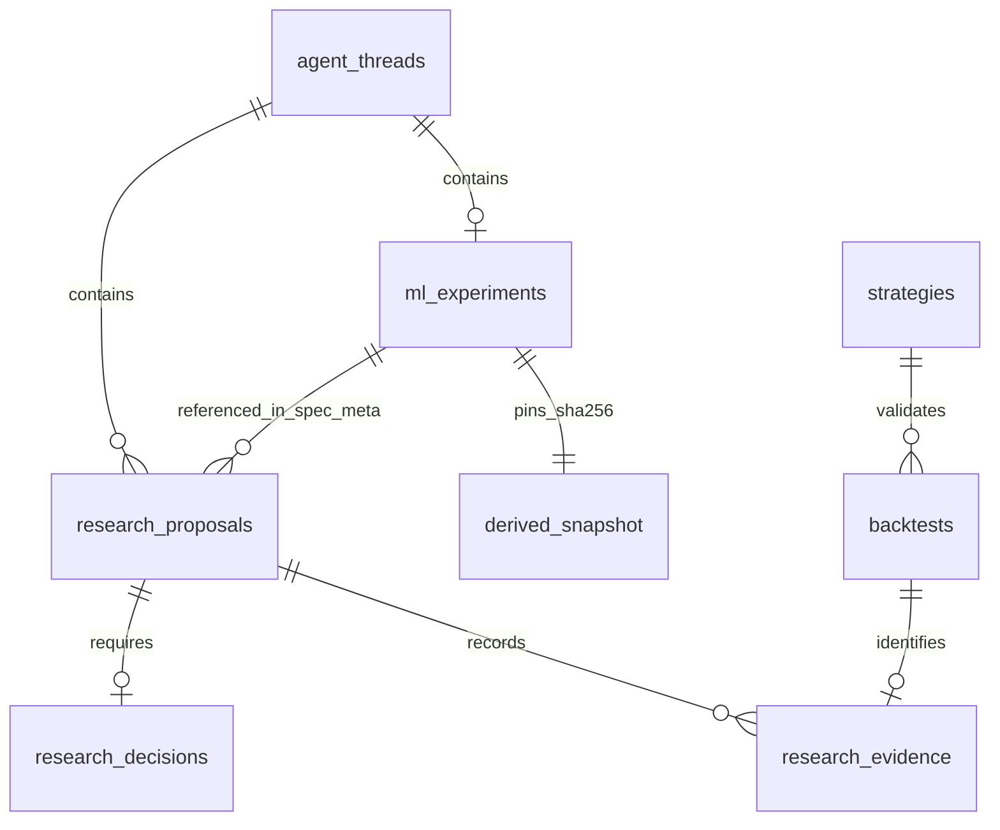

# Approval-gated multivariate MBO research

This is an opt-in **API workflow**, not a running research program. It freezes one
ES experiment, requires exact user approval before fitting, records explicit stop/no-edge
outcomes, and exports passing candidates into the existing separately approved Nautilus
workflow. No schedules, final-holdout access, paper/live execution or profitability claims
are added. Existing chat, strategies, charts, ingestion and storage remain available.
All implementation checks use **synthetic data**, including synthetic compressed DBN files.
The user's reported eight months of ES MBO has not been inspected or quality-verified here.

## Methods and features

The current MBO path jointly consumes the same six ordered features in both methods:

| Order | Feature | Definition at each one-minute close |
|---|---|---|
| 1 | `spread_ticks` | Best ask minus best bid, divided by configured ES tick size |
| 2 | `depth_imbalance` | `(bid size - ask size)/(bid size + ask size)` across up to the explicitly chosen N best levels on each side |
| 3 | `aggressive_buy_rate` | Contracts in T records with buyer aggressor B, divided by 60 seconds |
| 4 | `aggressive_sell_rate` | Contracts in T records with seller aggressor A, divided by 60 seconds |
| 5 | `add_rate` | Non-snapshot A record count divided by 60 seconds |
| 6 | `cancel_reduction_rate` | Size removed by C records divided by 60 seconds, including execution-related reductions |

`mbo_ridge_v1` fits one joint ridge regression to training forward outcomes. The user
specifies the regularization and predicted-net-tick signal threshold before fitting.
There is no search over thresholds or per-column winner selection.

`mbo_kmeans_v1` fits multivariate k-means to training features only. It never receives
outcomes or label timestamps. Deterministic farthest-first initialization starts from the
lexicographically first distinct standardized vector; ties use lexicographic order.
Lloyd iterations stop at unchanged assignments. Final cluster IDs follow lexicographic
standardized-center order, **not profitability or a scalar volume ranking**. The user
chooses active IDs and their interpretation before fitting; no automatic re-labeling,
restart, k search or return-based cluster selection occurs.

Both standardize each column with its training population mean and standard deviation.
A constant training column uses scale 1. The frozen feature order, scaler, coefficients or
centers, threshold/active IDs, feature version and model version are retained. Validation
and test data never change preprocessing or parameters. An undersized/empty cluster,
insufficient distinct vectors or exhausted convergence budget is a technical `blocked`
result. Failed economic criteria return `no_edge` under that exact plan.

Earlier `volume_threshold_v1` and `volume_regimes_v1` remain supported for compatibility
with existing proposals and tests. They are explicitly volume-only legacy baselines,
not the multivariate MBO path. Their existing request schemas remain visible in OpenAPI.

## Source, timing and quality contract

The MBO path reads local `market-data/raw/ES/YYYY-MM-DD.mbo.dbn.zst` files directly.
There is no fallback to OHLCV zero-filled flow, the identity-stripped replay cache,
end-of-second aggregated checkpoints, or the heatmap feed that omits small levels.
One fixed outright ES contract and daily publisher/instrument/channel IDs are approved
upfront. Raw DBN symbology must match those IDs and the chosen contract. No full-day-volume
front-month selection is used. Automatic contract rolls are deferred; select a suitable
fixed-contract date range explicitly.

The extractor starts from a complete vendor snapshot and maintains the full resting
order map using `replay.book.L3Book`. Snapshot adds initialize state without counting as
activity. T and F records do not alter the book; C performs the size reduction once.
Unknown trade sides contribute to OHLCV/unknown-volume audit, never to sell flow.
The approved maximum unknown-volume fraction applies to every minute with trades.

Rows cover `[minute open, minute close)` in **receive time**. Only complete F_LAST events
are visible. If an event spans the boundary, all its records become available with its
completion in the later minute. Late exchange events are never backfilled into earlier
features; their receive-time availability controls inclusion. Both price bars and feature
rows come from this same stream, and are available at the minute close. RTH is 09:30–16:00
America/New_York. Snapshot synthetic receive timestamps are allowed only for initialization;
ordinary bad receive timestamps, bad-book flags, aggregated/top-of-book inputs, regressing
receive times/sequences, duplicate/unknown orders and inconsistent reductions fail closed.
Intraday resets/snapshots require a separately reviewed dataset and currently fail closed.

The user supplies maximum book age (since the last resting mutation received),
event/receive clock difference and unknown-trade
fraction. Missing, stale, crossed or empty books and no-trade minutes are omitted and
counted; gaps are purged when constructing targets, never filled with zeros. N is a maximum
level count: a sparse side uses its actually available levels. Sequence checks establish
monotonicity per selected instrument; they **do not prove full channel packet continuity**.
Vendor gap flags are checked, but this is not an independent exchange-feed audit.

Semantics follow the vendor's [MBO schema](https://databento.com/docs/schemas-and-data-formats/mbo),
[record flags/actions](https://databento.com/docs/standards-and-conventions/common-fields-enums-types),
and [snapshot format](https://databento.com/docs/standards-and-conventions/mbo-snapshot).

## Workflow and approval boundaries

1. Create a thread with `POST /api/agent/threads`.
2. Submit a complete plan to `POST /api/agent/threads/{threadId}/ml-experiments`.
   This reads/validates raw records and freezes derived inputs; **no model fits**.
3. Review the immutable document/digest, including source file SHA-256 hashes, daily
   IDs, quality counters, contract, feature contract, code/config/dependency hashes,
   snapshot identity, partition counts and every model/target/evaluation choice.
4. `POST .../{id}/decision` with `digest`, `action: "approve"` and a nonempty reason
   records exact user approval. `reject_stop` stops the thread.
5. `POST .../{id}/run` reserves one fitting attempt durably before fitting. Retries,
   concurrent requests and stopped/running experiments cannot fit again. Technical
   failures are `blocked`; failed evaluation is `no_edge`. No automatic retries occur.
6. `GET .../ml-experiments` retains decisions, diagnostics, frozen model, metrics and
   terminal results. A revision requires a new thread and new approval; global attempt
   history remains visible, and external/manual trial counts remain unknown.
7. For `candidate`, `POST .../{id}/candidate-proposal` accepts `{strategy, testPlan}`.
   Supply all session, exit, sizing, cost and risk choices. Export inserts the frozen
   trigger and provenance, creating an **unapproved** ordinary research proposal.
8. The existing proposal approve/queue actions are required for Nautilus validation.
   MBO exports require bars mode, primary 1min, ES1!, the same direction, no entry
   sequence, no filters and no context timeframes. Their actual contract is the pinned
   outright displayed in the dataset and result. No catalog/front-month substitution occurs.

Nautilus reads the hash-verified snapshot's receive-time price bars and feature rows,
using the same bounded numeric `FrozenModel.predict` implementation as discovery.
The `frozen_mbo_signal` primitive refuses missing or mistimed rows. It accepts validated
JSON numeric parameters; no pickle or executable model payload is loaded. Code/config,
model, result and snapshot drift block execution. The spec alone is **not self-contained**:
its experiment record and snapshot must accompany it. There is no paper/live adapter.

For MBO proposals, `testPlan.dataPolicy` is `immutable_MBO_receive_time_snapshot`.
`is`, `wf1`, and `wf2` denote that experiment's training, validation and internal test
session ranges. They are repeated execution checks on already-used data, **not new OOS
evidence or rolling model refits**. Existing non-MBO proposals keep their original windows.
A dedicated discovery form is deferred; plans are entered through the API/OpenAPI `/docs`.

## Explicit plan inputs

All common fields are required; there is no executable default request:

| Fields | Meaning |
|---|---|
| `hypothesis`, `method` | User hypothesis and `mbo_ridge_v1` or `mbo_kmeans_v1` |
| `symbol`, `interval`, `direction` | ES1!, 1min, and explicitly long or short |
| `start`, `trainEnd`, `validationEnd`, `testEnd` | Ordered disjoint inclusive ET session partitions, entirely within frozen platform IS |
| `target`, `horizonBars` | `next_open_to_horizon_close_ticks`, explicit 1–60 minute bars; no implicit 30-second conversion |
| `roundTripCostTicks` | Nonnegative total estimated round-trip cost |
| `minEvaluationSignals`, `minMeanNetTicks`, `minImprovementOverBaselineTicks` | Explicit evaluation/stop criteria |
| `multipleTestingPolicy` | `descriptive_only_no_significance_claim` |
| `contract`, `contractSelection` | Outright such as ESU6; `fixed_contract_before_experiment` |
| `sources` | Sorted entries `{day, instrumentId, publisherId, channelId}` for every frozen session in the date range |
| `depthLevels`, `featureWindowSeconds` | Explicit 1–50 best price levels; 60-second windows |
| `maxBookAgeMs`, `maxEventLagMs`, `maxUnknownTradeFraction` | Explicit freshness/clock/unknown-aggressor quality tolerances |

Ridge additionally requires positive `ridgeAlpha`, `predictionThresholdTicks` and positive
`minTrainSignals`. Clustering instead requires `clusterCount` (2–8), `maxIterations`
(1–100), positive `minClusterSamples`, unique `activeClusters` IDs and an explicit
`interpretation`. Unknown fields/methods, missing choices and non-finite values fail closed.

The 366-day, 50,000-bar, 12 MB snapshot and 50-million-record-per-source-day ceilings
plus 100,000-record event and 500,000-resting-order memory ceilings are software limits,
not trading recommendations. Raw input is streamed and
only per-minute outputs plus the current full book/event are held; model matrices are
bounded. Snapshot capture is synchronous and may be expensive on real MBO. It has not
been benchmarked on the user's dataset; eight months of full RTH bars will exceed the
50,000-row ceiling. A larger/rolling/asynchronous research design needs explicit review.

## Chronology and reproducibility

Partitions precede label creation. At bar i close the feature vector is known. The
label is `(close[i+h] - open[i+1]) / tickSize`, multiplied by the chosen side, minus
round-trip cost. Label availability is close i+h. Targets must remain within the same
partition and ET RTH session, spanning h contiguous minute bars. Missing rows, session
endings and partition endings are purged. Neither labels nor their availability enter
unsupervised fitting.

Validation must meet the approved signal count/mean outcome and strictly improve upon
the better of always-signaling and no-signaling on the same per-observation denominator,
plus the approved improvement requirement. Only passing validation opens internal test
metrics. The model never refits after validation, and failed tests never trigger another
search. Overlapping forward labels are not independent observations or trade PnL.

The platform's final holdout stays unavailable. Nested walk-forward model selection,
purged CV, final-holdout release and statistical significance remain deferred. Different
execution exits/sizing/costs may change results: frozen signal parity does not imply PnL
parity between forward labels and a strategy backtest.

`data/research_cache/ml/{experimentId}.json` holds hash-pinned ordered price/feature rows.
Raw file hashes and quality/source metadata live in the approved experiment document.
Code fingerprints include the extractor, replay book, model/inference, engine and source
reader; dependency versions are pinned. Source file changes after capture do not change
the approved snapshot. Missing/tampered snapshots fail closed. Back up metadata and
snapshots together; no automatic cleanup or retention policy is added. A process crash
can leave a run `running`; it never auto-resumes.

## Separate account assessments

`POST .../{id}/accounts` accepts `jobId`, `propFirm` and `personal`. Each policy is
explicit or `null`; a missing policy returns `unassessed`, never a pass. The job must
belong to an approved strategy proposal exported from this discovery and thread.
The existing evidence verifier enforces completed ES IS/WF data scope, timestamp
consistency and artifact bounds. The response pins the trade artifact SHA-256.

Each supplied policy requires `name`, `startingEquity`, `minNetPnlUsd`,
`maxClosedTradeDrawdownPct`, `maxDailyNetLossUsd` and `minTrades`. Starting equity must
match the actual Nautilus run; different capital/sizing needs a newly approved run.
The policies are evaluated independently. Metrics are computed from net trade PnL,
chronological exits, and ET session groups, not from discovery labels. Missing trade,
fee, timestamp or session evidence remains `unassessed`.

`criteria_met` means only those specified observed metrics met the policy. It is
**not prop-firm eligibility**: unrealized/intraday loss, trailing equity floors,
consistency, payout and firm-specific rules are explicitly unassessed. Neither
policy is selected or populated for the user. Full rule semantics and the personal
account objective need user input before a broader evaluator is implemented.

## Current data pipeline and compatible medallion design

Current main was inspected at `d1cda50587a0b2d80ed7884ac2e2d6720e79395c` (merged PRs
#1 and #2). There were no `AGENTS.md` or local `.agents/skills/SKILL.md` files in the
checkout or workspace. Existing ingestion/storage is retained; PostgreSQL and S3
migration are not prerequisites. The architecture maps naturally to medallion layers:

| Layer | Existing implementation | Increment / next contract |
|---|---|---|
| Bronze | Databento DBN raw files, manifest hashes; optional existing S3 archive scripts | Preserve immutable vendor bytes and license/provenance metadata |
| Silver | Instrument config, front-month mapping, minute bars/trades/book Parquet, DuckDB queries | MBO research derives complete-event receive-time features directly from identified raw DBN; legacy tiers remain available |
| Gold | Frozen splits, Nautilus catalog, research evidence and strategy artifacts | Add content-hashed per-experiment feature-input snapshots and deterministic learned triggers |
| Metadata | SQLite/Alembic threads, proposals, decisions, strategies, backtests, evidence | Add `ml_experiments`; keep all completed, stopped and failed discovery history |

Only `ml_experiments` is a new physical table. It has a foreign key/unique constraint
on `thread_id`, immutable `document_json` + `digest`, immutable `decision_json`,
`status`, `result_json`, and creation time. The local derived snapshot is a hash-pinned
file; the experiment-to-proposal reference lives in `spec.meta.mlDiscovery`. No
speculative options tables are created.

Future GEX/Silver data needs stable underlying/option instrument identifiers,
contract expiration/strike/put-call, multiplier, venue, vendor observation time,
**available-at time**, revision and license/source hash. Gold features must record
calculation version and join to ES using available-at time, never later revised or
end-of-day values. Snapshot lineage should link raw inputs → normalized records →
feature calculations → approved experiment. These are proposed extension contracts;
there are no option/GEX feeds or inferred exposures in this increment.

Meaningful real ML work remains gated by licensed ES coverage and quality. This
checkout supplied no real market dataset. Existing raw quality, contract-roll effects,
bar corrections and point-in-time availability were not audited. The new checks
catch structural defects and missing sessions, not all market-data defects. Assess
these before interpreting the new feature models. Keep SQLite while local serialized approvals
suffice; consider PostgreSQL/object storage only with an explicit multi-user,
concurrency, retention and deployment requirement.

## Decisions still needed

- Which hypotheses, side, fixed contract, source IDs, depth/freshness policies, model parameters, prediction targets and horizons
  deserve explicit tests; these reference plugins do not settle them.
- Exact dates and minimum evidence, cost assumptions, search/stop budget, uncertainty
  policy and how/when a final holdout may be released.
- Firm/version-specific drawdown and loss semantics versus personal-account goals.
- Licensed data quality/coverage, point-in-time joins, retention and future options data.
- Dedicated discovery UI and any future scheduled learning or execution promotion.

The separate brainstorming conversation was represented by the parent-provided
excerpts, including the medallion/GEX goal; no access to its full private transcript
is claimed. None of its future aspirations authorize autonomous research or trading.
